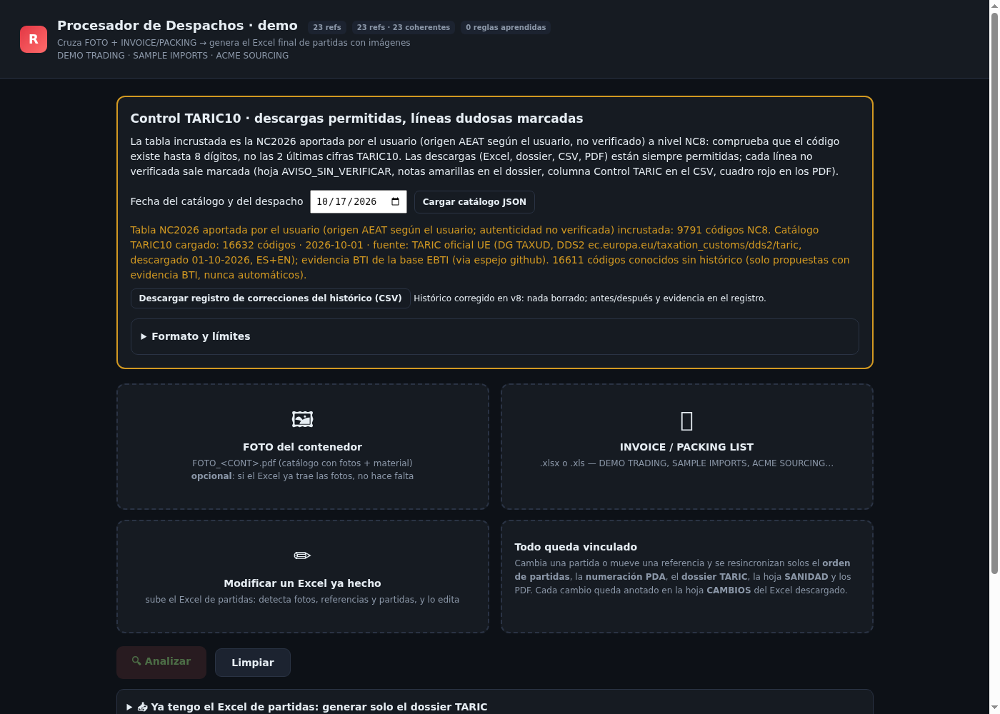

# Customs Clearance Processor (TARIC) - demo build

**English** | [Español](#español)

 

A single-file web app that turns a supplier's invoice + packing list (Excel) and an optional photo PDF into a customs-clearance workbook: suggested TARIC tariff codes per line, a grouped TARIC dossier, and cropped product photos per reference.

I built this tool and iterate on it in real customs-clearance work. This repository contains a **sanitized demo build for portfolio purposes**:

- All supplier, client and shipment data has been removed or replaced with **synthetic demo data** (fictional suppliers, references and products).
- The embedded tariff data is **official public EU data**: the TARIC 10-digit catalogue (DG TAXUD, dated 2026-10-01) and the Combined Nomenclature texts.
- Nothing here identifies any company, client, container or real clearance.

## Live demo

Try the demo build in your browser (no install): **https://andrescampomar2010-dotcom.github.io/customs-clearance-processor/**

Load `samples/demo-invoice-packing-demo-trading.xlsx` (synthetic invoice + packing list from a fictional supplier) to see it work.

## What it does

- Reads invoice and packing-list Excels from different suppliers, with automatic column detection (any order, mixed languages, Chinese sheet names).
- Suggests a TARIC code per line combining several evidence levels: exact validated reference, description + material family, product noun, legal rules and an embedded BTI (Binding Tariff Information) evidence base.
- Verifies every suggested code against the official TARIC10 catalogue and flags codes that do not exist or are not declarable.
- Produces the clearance Excel (weights reconciled to invoice totals), a single-sheet TARIC dossier, and per-reference product photos cropped from the photo PDF or from pictures embedded in the Excel.
- Keeps a review workflow: unconfirmed lines are flagged, every automatic decision can be undone, and operator corrections can be saved as local rules.

## Run it

Open `index.html` in Chrome or Edge. Everything runs locally in the browser; no server, no install. To try it, load `samples/demo-invoice-packing-demo-trading.xlsx` (synthetic invoice + packing list from a fictional supplier).

## Validation

`eval/validate_kb.py` checks the embedded knowledge bases for internal consistency: every code the app can suggest is well-formed and backed by the official TARIC snapshot (16,632 declarable codes, DG TAXUD 2026-10-01). Latest measured results in [eval/RESULTS.md](eval/RESULTS.md) - all 119 evidence codes pass.

## n8n workflows

The `n8n/` folder holds three example workflows I use as building blocks for automation around customs and document processing. Import the JSON into any n8n instance and replace the `REPLACE_WITH_*` placeholders with your own credentials/IDs:

1. **Invoice intake**: watches a mailbox for invoices, extracts line items with an LLM and appends them to Google Sheets, with a failure notification path.
2. **Customs tariff Q&A assistant**: a RAG chat that answers classification questions from public TARIC/CN texts, always citing the chapter and heading.
3. **Shipment ETA watch**: polls a tracking API daily and emails an alert when a container status or ETA changes.

## Tech

Vanilla JS single file, ExcelJS and pdf.js from CDN. No build step.

## Disclaimer

Tariff classification is a professional judgment. Suggestions from this tool are a starting point and must be confirmed by a licensed customs agent. The demo data is synthetic; any resemblance to real companies or products is unintended.

---

# Procesador de despachos (TARIC) - versión demo

App web de un solo archivo que convierte la factura y el packing list de un proveedor (Excel), más un PDF de fotos opcional, en el libro de despacho: propuesta de partida TARIC por línea, dossier TARIC agrupado y fotos de producto recortadas por referencia.

Es una herramienta que construí y mejoro en trabajo real de despacho de aduanas. Este repositorio contiene una **versión demo saneada para portfolio**:

- Todos los datos de proveedores, clientes y envíos se han eliminado o sustituido por **datos sintéticos** (proveedores, referencias y productos ficticios).
- Los datos arancelarios embebidos son **datos públicos oficiales de la UE**: el catálogo TARIC a 10 dígitos (DG TAXUD, 01-10-2026) y los textos de la Nomenclatura Combinada.
- Nada en el repositorio identifica a ninguna empresa, cliente, contenedor o despacho real.

## Qué hace

- Lee facturas y packing lists de distintos proveedores con autodetección de columnas (cualquier orden, idiomas mezclados, hojas en chino).
- Propone la partida de cada línea combinando niveles de evidencia: referencia validada, descripción + familia de material, nombre del producto, reglas legales y base de evidencia BTI (resoluciones de clasificación arancelaria vinculante).
- Verifica cada código contra el catálogo oficial TARIC10 y avisa de códigos inexistentes o no declarables.
- Genera el Excel de despacho (pesos cuadrados con la factura), el dossier TARIC de una sola hoja y las fotos por referencia recortadas del PDF o incrustadas en el Excel.
- Flujo de revisión: líneas sin confirmar marcadas, deshacer en cada decisión automática y reglas locales guardadas a partir de correcciones del operador.

## Cómo probarla

Abre `index.html` en Chrome o Edge. Todo funciona en local, sin servidor. Para probarla, carga `samples/demo-invoice-packing-demo-trading.xlsx` (factura + packing sintéticos de un proveedor ficticio).

## Flujos n8n

La carpeta `n8n/` incluye tres flujos de ejemplo que uso como piezas para automatizar el trabajo documental y de aduanas. Importa el JSON en cualquier instancia de n8n y sustituye los marcadores `REPLACE_WITH_*` por tus credenciales/IDs:

1. **Entrada de facturas**: vigila un buzón, extrae las líneas con un LLM y las vuelca en Google Sheets, con aviso si falla.
2. **Asistente arancelario**: chat RAG que responde dudas de clasificación con los textos públicos del TARIC/NC, citando siempre capítulo y partida.
3. **Vigilancia de ETA**: consulta una API de tracking a diario y avisa por correo si cambia el estado o la ETA de un contenedor.

## Aviso

La clasificación arancelaria es un juicio profesional: las propuestas de la herramienta son un punto de partida y debe confirmarlas un agente de aduanas. Los datos de demo son sintéticos; cualquier parecido con empresas o productos reales es involuntario.
